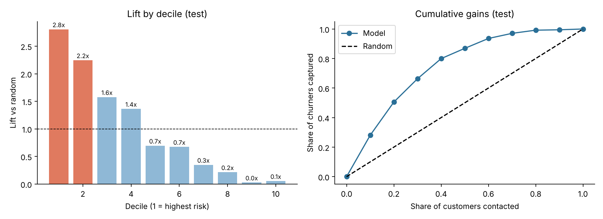

# Telecom Churn Risk Model

A cost-aware, calibrated and explainable churn model for a (fictional) Chennai telecom operator, built with **pandas + scikit-learn pipelines** on the public IBM Telco Customer Churn dataset (7,043 customers, ~26.5% churn).

## Results (20% held-out test set)

| Metric | Result |
|---|---|
| Test ROC AUC (calibrated Random Forest) | **0.847** (target ≥ 0.84) |
| Test PR AUC | 0.657 (random = 0.265) |
| Lift in top 2 deciles | **2.52x**, captures 50.5% of churners by contacting 20% of customers |
| Cost-optimal threshold (missed churner = 5x wasted offer) | 0.165 (theory: 1/6) |
| Cost vs best naive policy | ~40% lower |

| Model | CV ROC AUC | Test ROC AUC | Test PR AUC |
|---|---|---|---|
| Logistic Regression | 0.8469 | 0.8453 | 0.6530 |
| Random Forest | 0.8483 | 0.8466 | 0.6575 |
| Gradient Boosting | 0.8473 | 0.8460 | 0.6598 |



## What is inside

| File | Purpose |
|---|---|
| `Telecom_Churn_Risk_Model.ipynb` | Full executed notebook: cleaning, ablation, tuning, calibration, cost threshold, lift, SHAP, segments |
| `churn_utils.py` | `clean_telco()`, stateless `FeatureEngineer` (15 features) and `make_preprocessor()` (ColumnTransformer) |
| `churn_model.joblib` | Calibrated model + decision threshold + cost settings |
| `telco.csv` | IBM Telco Customer Churn data |
| `model_comparison.csv`, `ablation_table.csv`, `decile_lift_table.csv`, `retention_segments.csv` | Result tables |
| `*.png` | Figures (lift chart, SHAP, calibration, cost curve, ablation, EDA) |
| `report/` | Full project report (DOCX + PDF) and two-page summary |

## Method in short

1. **Cleaning:** 11 blank `TotalCharges` (all tenure = 0) set to 0; "No internet service" / "No phone service" merged into "No".
2. **No leakage:** row-wise cleaning only; imputation, scaling and encoding are inside the `Pipeline`; features are stateless; the test set is used once.
3. **Features:** 15 engineered features in 5 families (tenure, charges, bundles, contract, risk flags). Ablation shows only small gains (within about ±0.002 AUC); they mainly help interpretability.
4. **Models:** Logistic Regression, Random Forest, Histogram Gradient Boosting; `RandomizedSearchCV` with stratified 5-fold CV; class weights for imbalance.
5. **Calibration and threshold:** sigmoid calibration (Brier 0.158 → 0.135); threshold chosen from the 5:1 cost matrix on out-of-fold predictions.
6. **Explainability:** SHAP global and per-customer; three retention segments with actions.

## Key churn drivers

Month-to-month contracts, short tenure (first 6 months), fibre-optic customers without tech support or security, electronic-check payment.

## Run it

```bash
python -m venv .venv && source .venv/bin/activate   # Windows: .venv\Scripts\activate
pip install -r requirements.txt
jupyter notebook Telecom_Churn_Risk_Model.ipynb
```

Use the saved model:

```python
import joblib, pandas as pd
import churn_utils as u            # must be importable so the pipeline can be unpickled
b = joblib.load("churn_model.joblib")
df = u.clean_telco(pd.read_csv("telco.csv"))
X = df.drop(columns=["Churn", "customerID"])
p = b["model"].predict_proba(X)[:, 1]
flag = p >= b["threshold"]          # customers to contact
```

> The `.joblib` file was saved with the library versions in `requirements.txt`. If loading fails with a different scikit-learn version, re-run the notebook to regenerate it.

## Limitations

Single-snapshot public dataset (no out-of-time validation); the Chennai setting is fictional; simplified cost matrix; the model predicts who will churn, not who will respond to an offer (an A/B holdout is recommended).

## Author

[Soniya Singh] · B.Tech CSE (AI/ML)
